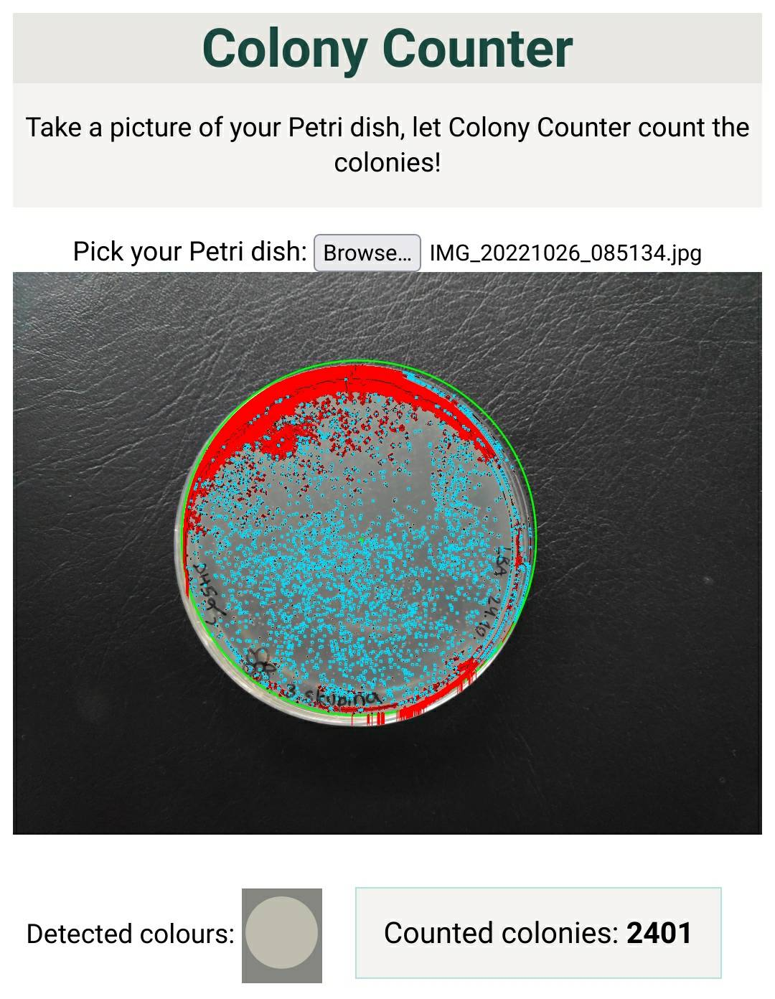
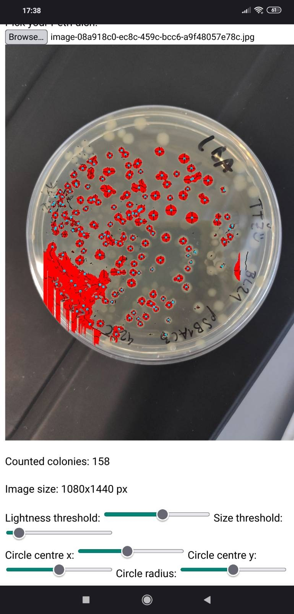
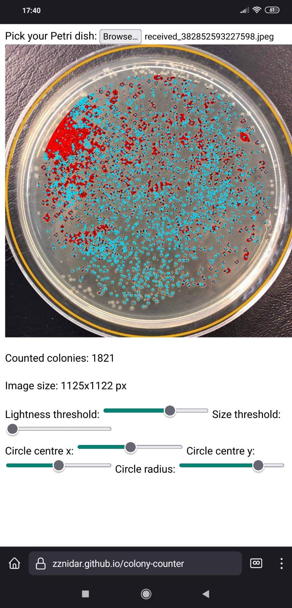
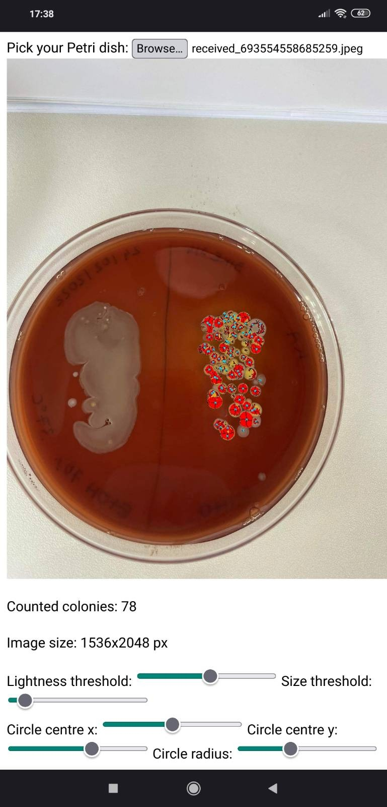

# colony-counter
Automatically count colonies from a photo of your Petri dish. Available here: https://zznidar.github.io/colony-counter/  

Tired of counting colonies of bacteria manually? Just take a photo and read the result :)  

A prototype.

## Awards
Colony Counter was awarded the 3rd award for the best student ICT-project at the [DSI 2022 conference](https://dsi2022.dsi-konferenca.si/).

## How to use
1. Pick a photo of your Petri dish.
2. Should AI detect it poorly, adjust settings:
    * **Background colour**: Colour of the agar. Select it on your photo.
    * **Colour of colonies**: Colour of the colonies. Select it on your photo.
    * **Size threshold**: How large the colonies are. This is to prevent little flares from being counted as colonies
    * **Circle**: To avoid counting dust and dirt on your table, only a circular part of the picture is analysed. Set the centre and radius of that circle.
    * **Dark colonies**: Inverts the detected colours. If you set the colours manually, don't check this box.
    * **Ignore lines** _(default)_: Uses a self-expanding inhibitory field to avoid counting lines as tens of colonies. This also filters colonies by size ratio (eliminating your marker even further). 

Red colour represents areas of colonies. Blue squares show the centre of each colony. White squares denote ignored areas (by size ratio). **Count is shown below the image**. 

## Screenshots
   
